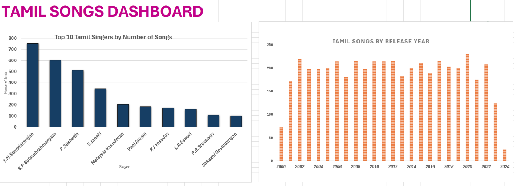
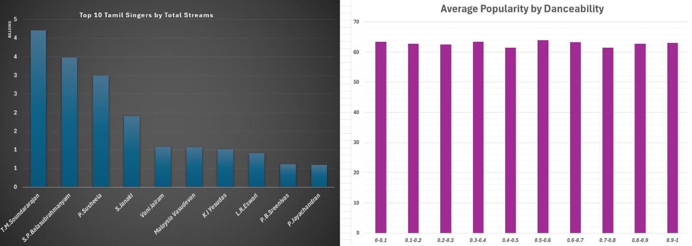

# Tamil Songs Analysis (Excel)

Analysis of 4,677 Tamil songs from a Spotify dataset (Kaggle) using Excel.

## Dashboard

## Questions
- Which singers have the most songs and streams?
- How many songs were released each year?
- Does danceability or energy affect popularity?

## Findings
1. T.M. Soundararajan has the most songs (753) and the most streams (about 4.2 billion).
2. The top 3 singers have far more streams than the rest of the top 10.
3. Songs are spread fairly evenly across release years 2001 to 2022.
4. Danceability and popularity have almost no relationship (correlation about -0.006).
5. Energy and popularity have almost no relationship (correlation about -0.007).

## Notes
- Duets are count
